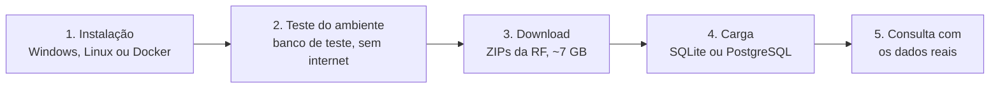

[← Voltar ao README](../README.md)

# Guia de uso: da instalação aos dados reais

Este guia segue o caminho completo, em cinco etapas. As duas primeiras levam poucos minutos e usam o banco de teste que já vem no repositório. As três últimas trabalham com a base real da Receita Federal (RF), que tem dezenas de GB e leva horas para carregar.



1. [Instalação](#1-instalação)
2. [Teste do ambiente](#2-teste-do-ambiente)
3. [Download dos arquivos da Receita](#3-download-dos-arquivos-da-receita)
4. [Carga no banco](#4-carga-no-banco)
5. [Consulta com os dados reais](#5-consulta-com-os-dados-reais)

Referência: [Arquivo .env](#arquivo-env) · [Problemas comuns](#problemas-comuns)

**Como ler os comandos.** Todos rodam na raiz do projeto e usam `python`. Com o ambiente virtual ativado, `python` e `python3` são o mesmo; no Windows o comando é `python` ou `py`. Nos ambientes Docker, coloque `docker compose run --rm cnpj-full` antes de cada comando (ex.: `docker compose run --rm cnpj-full python cnpj_full/consulta.py ...`).

---

# 1. Instalação

Escolha um dos quatro ambientes. Em todos é preciso o [Git](https://git-scm.com/downloads) para clonar o repositório. Sem Docker, é preciso também o **Python 3.13 ou superior** (versão mínima do projeto) e as bibliotecas do `requirements.txt` (`pandas`, `numpy`, `numexpr`, `networkx`, `python-dotenv` e `psycopg[binary]`), instaladas num ambiente virtual.

Ambiente | Quando usar
-------- | -----------
[Windows](#windows) | Python instalado no Windows
[Linux](#linux) | Python instalado no Linux (ou no WSL)
[Docker no Windows](#docker-no-windows) | Docker Desktop, sem instalar Python
[Docker no Linux](#docker-no-linux) | Docker Engine, sem instalar Python. Também é a melhor opção no Windows para carregar a base completa, com o projeto dentro do WSL

Ao final, siga para o [teste do ambiente](#2-teste-do-ambiente).

## Windows

Instale o Python 3.13 ou superior pelo [python.org](https://www.python.org/downloads/windows/) (marque *Add python.exe to PATH*). No PowerShell:

```powershell
git clone https://github.com/bjverde/CNPJ-full.git
cd CNPJ-full
py -m venv .venv
.venv\Scripts\Activate.ps1          # no cmd: .venv\Scripts\activate.bat
python -m pip install -r requirements.txt
```

Se o PowerShell recusar o `Activate.ps1` (*a execução de scripts foi desabilitada neste sistema*), libere só para o seu usuário e tente de novo:

```powershell
Set-ExecutionPolicy -Scope CurrentUser RemoteSigned
```

Nos comandos, as barras podem ser `/` ou `\` (`cnpj_full/consulta.py` ou `cnpj_full\consulta.py`). A `.venv` do Windows não serve dentro do Docker, mas pode ficar na pasta: a imagem Docker não a usa.

## Linux

O Debian 13 já vem com o Python 3.13:

```bash
sudo apt install python3 python3-venv git
python3 --version    # precisa ser 3.13 ou superior
```

Distribuições com Python mais antigo (ex.: Ubuntu 24.04 vem com 3.12, Debian 12 com 3.11) precisam instalar o 3.13 à parte (ex.: `pyenv` ou, no Ubuntu, o PPA deadsnakes) e criar o ambiente virtual com ele (`python3.13 -m venv .venv`), ou usar o Docker.

O ambiente virtual é obrigatório no Debian 12/13 e no Ubuntu 23.04 ou mais novo: `pip install` direto no Python do sistema dá o erro *externally-managed-environment* (PEP 668).

```bash
git clone https://github.com/bjverde/CNPJ-full.git
cd CNPJ-full
python3 -m venv .venv
source .venv/bin/activate
pip install -r requirements.txt
```

Sem ativar o venv, use o caminho completo: `.venv/bin/python cnpj_full/consulta.py ...` (útil em cron e scripts).

## Docker no Windows

Instale o [Docker Desktop](https://www.docker.com/products/docker-desktop/) (com WSL 2). Não precisa de Python no Windows. No PowerShell:

```powershell
git clone https://github.com/bjverde/CNPJ-full.git
cd CNPJ-full
docker compose build
```

O [`Dockerfile`](../Dockerfile) cria uma imagem só com o Python 3.13 e as bibliotecas. O código **não é copiado para a imagem**: o [`docker-compose.yml`](../docker-compose.yml) monta a pasta do projeto em `/app`. Assim os resultados aparecem na pasta do projeto no Windows e mudanças no código valem sem refazer a imagem.

Observações:

* Não é preciso definir `CNPJ_UID`/`CNPJ_GID`: o Docker Desktop já grava os arquivos como seu usuário.
* **Não crie venv na pasta do projeto pelo container.** Um venv criado no volume do Windows fica sem `pip` funcionando. As bibliotecas já estão na imagem, fora do volume.
* Arquivos no disco do Windows (`C:\...`, `D:\...`) acessados pelo container são bem mais lentos. Para o banco de teste não faz diferença; para a [carga da base completa](#4-carga-no-banco), prefira deixar o projeto e os dados dentro do WSL (ex.: `\\wsl$\Ubuntu\home\voce\CNPJ-full`) e seguir o [Docker no Linux](#docker-no-linux).
* O `.gitattributes` mantém `Dockerfile` e `*.yml` com quebra de linha LF mesmo clonando no Windows.

## Docker no Linux

Instale o Docker Engine com o plugin `docker compose` (ou o Docker Desktop no Linux). Vale também para o WSL 2 com o projeto dentro do Linux do WSL.

```bash
git clone https://github.com/bjverde/CNPJ-full.git
cd CNPJ-full
# Seu usuário no container, para os arquivos gerados não ficarem do root
printf 'CNPJ_UID=%s\nCNPJ_GID=%s\n' "$(id -u)" "$(id -g)" >> .env
docker compose build
```

Observações:

* Sem `CNPJ_UID`/`CNPJ_GID`, o container roda como root e os arquivos gerados ficam do root (para apagar, só com `sudo`). A pasta do projeto precisa ser gravável pelo seu usuário.
* Com SELinux ativo (Fedora, RHEL, Rocky), acrescente `:z` ao volume (`- ./:/app:z`) se aparecer *Permission denied* dentro do container.
* Sem compose, o equivalente de `docker compose run --rm cnpj-full` é:

  ```bash
  docker build -t cnpj-full .
  docker run --rm --user "$(id -u):$(id -g)" -v "$PWD":/app -w /app cnpj-full python cnpj_full/consulta.py ...
  ```

## Usando outra imagem Docker (ex.: Debian 13 do cnpjrfb)

Numa imagem que não é a deste repositório, o Python é o do sistema e vale a PEP 668. Crie o venv **fora do volume**, num caminho da imagem:

```dockerfile
RUN apt-get update && apt-get install -y --no-install-recommends python3 python3-venv \
 && python3 -m venv /opt/cnpj-full-venv
COPY requirements.txt /tmp/requirements.txt
RUN /opt/cnpj-full-venv/bin/pip install -r /tmp/requirements.txt
```

E rode com o Python do venv: `/opt/cnpj-full-venv/bin/python /caminho/CNPJ-full/cnpj_full/consulta.py ...`. Um venv dentro da pasta montada do host (principalmente no Windows) fica sem `pip` e quebra a cada recriação do container.

---

# 2. Teste do ambiente

O teste usa o [banco de teste](#banco-de-teste), com dados fictícios, que é o banco padrão quando não há `.env` nem `--base`. Não precisa de internet. São os mesmos comandos em todos os ambientes (no Docker, com o prefixo `docker compose run --rm cnpj-full`):

```bash
# 1. Consulta no banco de teste e grafo (abra resultado/grafo.html no navegador)
python cnpj_full/consulta.py cnpj 10000001000190 resultado --nivel 3 --viz --csv

# 2. Carga: gera ZIPs de teste no formato da RF e carrega com o carga.py
python dados/teste/gerar_banco_teste.py --saida saida/teste/cnpj_teste.db --zips dados/teste/zips
python cnpj_full/carga.py dados/teste/zips sqlite saida/teste/carga --dir

# 3. Consulta na base recém-carregada
python cnpj_full/consulta.py cnpj 20000001000143 saida/teste/resultado --base saida/teste/carga/CNPJ_full.db --viz
```

Para abrir o grafo: `start resultado\grafo.html` (Windows), `xdg-open resultado/grafo.html` (Linux) ou abra o arquivo no navegador.

O que conferir:

* o passo 1 termina com `Consulta finalizada` e gera `resultado/grafo.html`, `pessoas.csv` e `vinculos.csv`;
* o grafo abre no navegador mesmo sem internet (o d3.js vem embutido) e mostra a holding ligada às controladas;
* o passo 2 mostra a `Verificacao das quantidades por arquivo` com todos os arquivos `OK` e `Indices criados com sucesso`;
* no Docker, os arquivos aparecem na pasta do projeto no seu computador.

Outros CNPJs de exemplo, com o tamanho do grafo em cada nível, estão em [consultas de exemplo](#consultas-de-exemplo). Os testes automáticos rodam estes mesmos comandos a cada PR ([Desenvolvimento](desenvolvimento.md#testes)).

O passo 2 grava os ZIPs de teste em `dados/teste/zips/` e os passos 2 e 3 gravam o resto em `saida/teste/`. Para limpar, apague `resultado`, `saida/teste` e `dados/teste/zips`. Todas as pastas que o programa cria ficam fora do git ([pastas geradas](desenvolvimento.md#pastas-geradas)).

## Banco de teste

O arquivo [`dados/teste/cnpj_teste.db`](../dados/teste) é um banco SQLite pequeno (cerca de 200 KB) com o mesmo modelo da base completa (o mesmo do [cnpjrfb](https://github.com/bjverde/cnpjrfb)). Ele é versionado no git, então funciona logo depois do `git clone`, e é o banco padrão do `consulta.py` quando não se informa `--base` nem `CNPJ_DB_ARQUIVO` no `.env` ([qual banco a consulta usa](#qual-banco-a-consulta-usa)).

**Todos os dados são fictícios**: nomes de empresas e pessoas são inventados e os CPFs seguem o formato mascarado da RF (`***123456**`). Só as tabelas de domínio (CNAEs, municípios, naturezas jurídicas, qualificações, países e motivos) usam códigos reais. Assim o banco pode ficar no repositório sem problema de LGPD.

Conteúdo: 202 empresas, 236 estabelecimentos, 311 sócios e 96 optantes do Simples. Há quatro grupos econômicos montados para o grafo ter ligações até o nível 3, além de cerca de 180 empresas avulsas cujos sócios aparecem em várias empresas.

### Consultas de exemplo

Exemplo: `python cnpj_full/consulta.py cnpj 50000001000104 resultado --nivel 3 --viz`. O nível padrão é 3. A coluna "nós" é o número de empresas e pessoas no grafo com `--nivel 1`, `2` e `3`:

Consulta | O que mostra | Nós (nível 1 / 2 / 3)
-------- | ------------ | ---------------------
`cnpj 10000001000190` | **ALFA HOLDING**: 4 controladas ativas e 1 baixada, controlada de controlada, filiais, sócio estrangeiro, administradora comum a várias empresas | 9 / 11 / 13
`cnpj 50000001000104` | **CHARLIE PARTICIPACOES**: cadeia holding > indústria > distribuidora > logística, com a logística no nível 3 | 4 / 7 / 9
`cnpj 50000004000148` | **CHARLIE LOGISTICA**: a mesma cadeia vista de baixo para cima, até a holding | 3 / 4 / 7
`cnpj 60000001000168` | **PADARIA DELTA**: empresas de uma família ligadas só por pessoas, sem holding; uma sócia também é sócia do restaurante do presidente do grupo ALFA | 4 / 6 / 8
`cnpj 20000001000143` | **BRAVO SERVICOS**: grupo menor, controlada de controlada e sócio PJ que não está na base | 4 / 5 / 6
`cnpj 40000006000183` | **CONTABILIDADE ESTRELA LUAR**: empresa avulsa; os sócios estão em muitas empresas, rede grande | 4 / 22 / 32
`nome_socio "ANA TEIXEIRA HENRIQUES"` | Busca por pessoa: filho da família DELTA, sócio de duas empresas | 3 / 5 / 8

Os testes automáticos (`tests/test_banco_teste.py`) conferem esses números.

### Recriando o banco

O banco é gerado pelo [`dados/teste/gerar_banco_teste.py`](../dados/teste/gerar_banco_teste.py), que cria ZIPs no formato da RF e carrega com o próprio `cnpj_full/carga.py`. A geração é determinística: rodar de novo gera os mesmos dados. Os testes automáticos conferem que o `.db` versionado está igual ao que o script gera.

```bash
python dados/teste/gerar_banco_teste.py                       # recria dados/teste/cnpj_teste.db
python dados/teste/gerar_banco_teste.py --zips dados/teste/zips   # guarda também os ZIPs (para testar a carga)
```

---

# 3. Download dos arquivos da Receita

```bash
python cnpj_full/download.py --listar    # mostra a competência mais recente e os arquivos, sem baixar
python cnpj_full/download.py             # baixa tudo para dados/AAAA-MM/
```

São cerca de 7 GB de ZIPs por competência. Pode rodar de novo à vontade: arquivos já baixados são pulados e um download interrompido continua de onde parou. No Docker, a pasta `dados/` fica dentro da pasta do projeto no seu computador.

Outra competência, outra pasta de destino, filtro de arquivos e proxy: [Download](download.md).

---

# 4. Carga no banco

A carga lê os ZIPs da competência e grava as tabelas do mesmo modelo do [cnpjrfb](https://github.com/bjverde/cnpjrfb). Reserve no disco, além dos ZIPs, pelo menos o mesmo tanto para o banco. A carga completa leva horas.

**SQLite** (gera `saida/CNPJ_full.db`, com índices):

```bash
python cnpj_full/carga.py dados/2026-10 sqlite saida --dir
```

**PostgreSQL**: configure a conexão no [`.env`](#arquivo-env) (variáveis em [Carga no PostgreSQL](postgresql.md#configuração-env)) e rode:

```bash
python cnpj_full/carga.py dados/2026-10 postgres --dir
```

Troque `2026-10` pela competência baixada (o `download.py` mostra o comando certo no fim). Saída em CSV, modo `--seguro`, retomada com `--continuar` e verificação das quantidades: [Carga](carga.md).

---

# 5. Consulta com os dados reais

Aponte o `CNPJ_DB_ARQUIVO` do [`.env`](#arquivo-env) para o banco carregado:

```
CNPJ_DB_ARQUIVO=saida/CNPJ_full.db
```

E consulte como no teste, agora com CNPJs reais:

```bash
python cnpj_full/consulta.py cnpj 00000000000191 resultado --nivel 2 --viz
```

Sem mexer no `.env`, dá para usar `--base saida/CNPJ_full.db` em cada comando. A primeira linha da saída (`Banco: ...`) mostra qual banco foi usado.

Por enquanto as consultas leem só SQLite; ler do PostgreSQL é o próximo passo. Tipos de consulta (por nome de sócio, CPF, arquivo com vários itens), níveis, formatos de saída e cache: [Consultas e grafo](consultas.md).

---

# Arquivo .env

O `.env` fica **na raiz do projeto**, ao lado do `README.md` (é lá que o programa procura, não na pasta onde você roda o comando). Ele não vai para o git. Para criar a partir do exemplo:

```bash
cp .env.example .env                 # Linux, macOS, Docker
copy .env.example .env               # Windows (cmd)
Copy-Item .env.example .env          # Windows (PowerShell)
```

Sem `.env` tudo funciona com os padrões: as consultas usam o banco de teste e o download grava em `dados/`. O [`.env.example`](../.env.example) traz todas as variáveis, comentadas, em três partes: **consultas** (`CNPJ_DB_ARQUIVO`, o SQLite das consultas), **carga em SGBD** (um bloco de conexão para cada banco; deixe sem `#` só um) e **download e outros**. Hoje a carga funciona em SQLite, CSV e PostgreSQL e as consultas só em SQLite; os blocos de MySQL/MariaDB, SQL Server e Oracle já mostram os nomes que serão usados.

* Variáveis já definidas no ambiente (ex.: `docker run -e`, `export`, `set`) têm prioridade sobre o `.env`.
* Caminhos relativos no `.env` partem da **raiz do projeto**, não da pasta onde você roda o comando.
* Para usar um `.env` em outro lugar, defina `CNPJ_ENV=<caminho>` no ambiente.

Variável | Para que serve | Detalhes
-------- | -------------- | --------
`CNPJ_DB_TIPO` | Reservado: ainda não é lido. O SGBD da carga vai na linha de comando (`carga.py ... postgres`) | 
`CNPJ_DB_ARQUIVO` | Arquivo SQLite das consultas quando não se passa `--base` | abaixo
`CNPJ_DB_HOST`, `CNPJ_DB_PORTA`, `CNPJ_DB_NOME`, `CNPJ_DB_USUARIO`, `CNPJ_DB_SENHA`, `CNPJ_DB_SCHEMA` | Conexão com o SGBD | [PostgreSQL](postgresql.md#configuração-env)
`CNPJ_RF_URL`, `CNPJ_PASTA_DOWNLOAD` | Endereço da RF e pasta dos ZIPs | [Download](download.md)
`CNPJ_NAVEGADOR` | Navegador aberto sozinho com o `grafo.html` (`--viz`). Vazio: só gera o arquivo | [Consultas](consultas.md#configuração-cnpj_fullconfigpy)
`CNPJ_UID`, `CNPJ_GID` | Só Docker no Linux: usuário que roda o container | [Docker no Linux](#docker-no-linux)
`FILES_LOCATION` | Só scripts `extra_csv`: pasta do `estabelecimento.csv` (padrão `saida`) | [Carga](carga.md#separando-o-csv-por-uf-ou-município)

## Qual banco a consulta usa

Ordem | De onde vem | Caminho relativo é relativo a...
----- | ----------- | --------------------------------
1 | `--base <arquivo>` na linha de comando | pasta onde você roda o comando
2 | `CNPJ_DB_ARQUIVO` no ambiente ou no `.env` | **raiz do projeto**
3 | Banco de teste `dados/teste/cnpj_teste.db` | raiz do projeto

Cuidados com o caminho:

* **Prefira caminho relativo** (ex.: `saida/CNPJ_full.db`). O mesmo `.env` serve no Windows, no Linux e no Docker, porque no container a pasta do projeto vira `/app`.
* Caminho absoluto do Windows (`D:/dados/...`) **não existe dentro do container**. Para usar uma base em outra pasta, monte-a em `/dados` no `docker-compose.yml` e use `CNPJ_DB_ARQUIVO=/dados/CNPJ_full.db`:

  ```yaml
      volumes:
        - ./:/app
        - D:/dados/cnpj:/dados          # Linux: - /srv/dados/cnpj:/dados
  ```

* No Windows, escreva o caminho com barras normais (`D:/dados/CNPJ_full.db`), sem aspas ou com aspas simples (`'D:\dados\CNPJ_full.db'`). **Não use aspas duplas com barra invertida**: em `"D:\dados\novo.db"` o `\n` vira uma quebra de linha.

---

# Problemas comuns

Sintoma | Causa e solução
------- | ---------------
`can't open file '.../consulta.py': No such file or directory` | O código fica na pasta `cnpj_full/`. Use `python cnpj_full/consulta.py ...` a partir da raiz do projeto (ou o caminho completo de qualquer pasta).
`ERRO: banco SQLite nao encontrado: ...` | O caminho do banco está errado. Veja o caminho mostrado e [qual banco a consulta usa](#qual-banco-a-consulta-usa). No `.env` o caminho relativo parte da raiz do projeto.
`no such table: estabelecimento` | O arquivo existe mas está vazio ou não é uma base do CNPJ-full (ex.: um `.db` vazio criado por engano). Confira o caminho e, se o arquivo estiver vazio, apague-o.
`error: externally-managed-environment` | `pip install` no Python do sistema (Debian 12/13, Ubuntu 23.04+). Use um venv ([Linux](#linux)) ou, em Docker, a imagem deste repositório ou um venv em `/opt` ([outra imagem](#usando-outra-imagem-docker-ex-debian-13-do-cnpjrfb)).
`No module named pip` / venv sem pip | venv criado no volume do Windows por dentro do container. Apague a pasta do venv e use a imagem deste repositório (sem venv) ou um venv em `/opt`.
`No module named 'pandas'` (ou `networkx`) | Bibliotecas não instaladas no Python usado. Ative o venv e rode `pip install -r requirements.txt`.
`python3` não encontrado no Windows | No Windows use `python` ou `py`.
Arquivos gerados pertencem ao root (Linux) | Defina `CNPJ_UID` e `CNPJ_GID` no `.env` ([Docker no Linux](#docker-no-linux)).
`Permission denied` ao gravar no volume (Linux) | A pasta do projeto não é gravável pelo usuário do container, ou SELinux: use `:z` no volume.
Caminho do Windows no `.env` com caractere estranho | Aspas duplas com `\`. Use barras normais `D:/dados/x.db` ou aspas simples.
O grafo abre em branco | Abra o `grafo.html` direto do disco num navegador atual (Chrome, Edge, Firefox). Ele não precisa de internet nem de servidor web.
